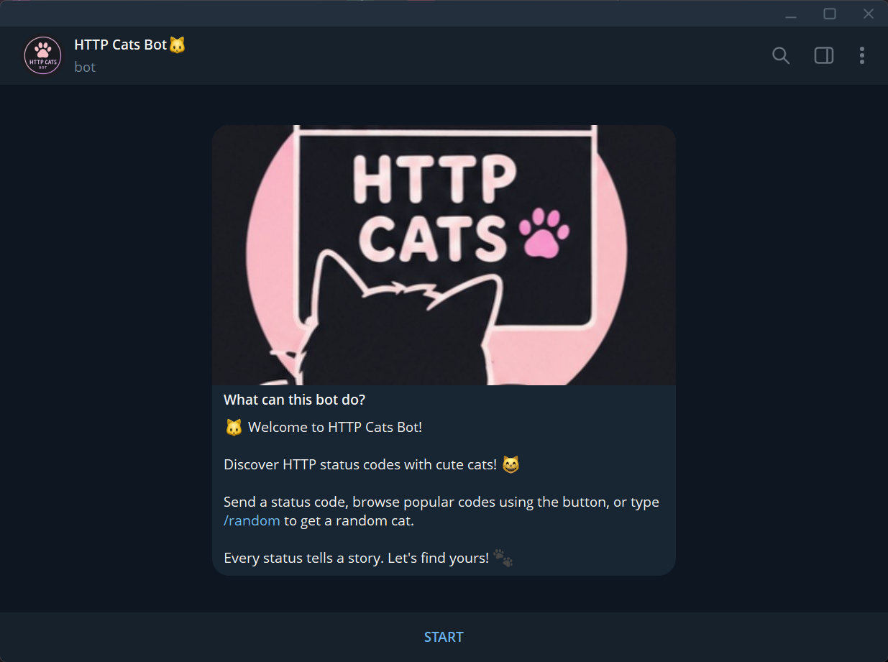
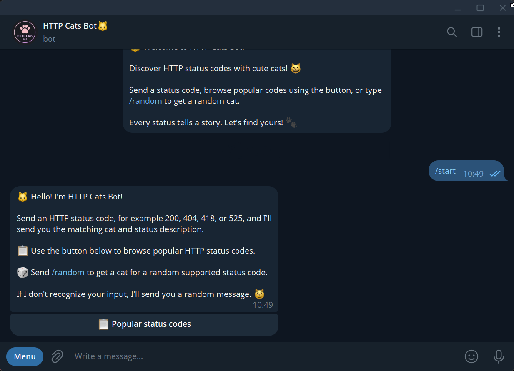
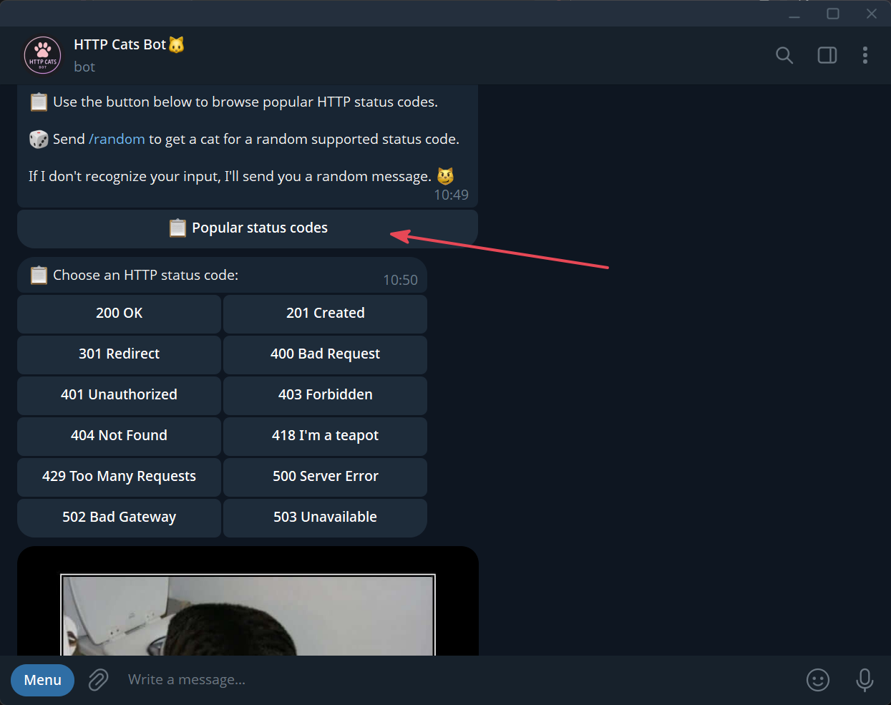
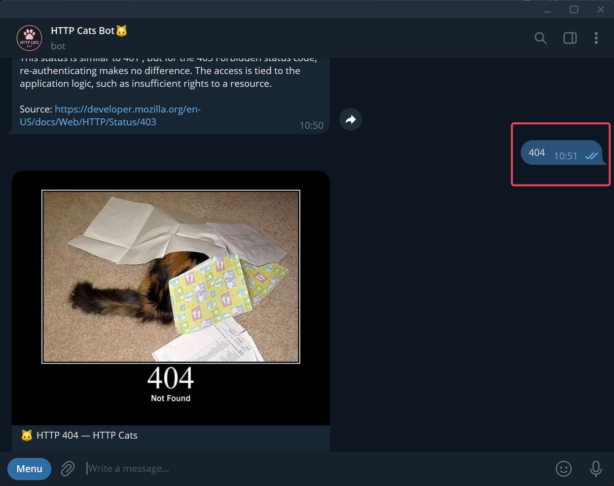
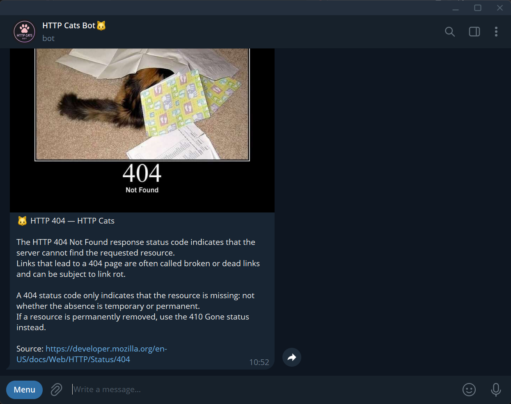
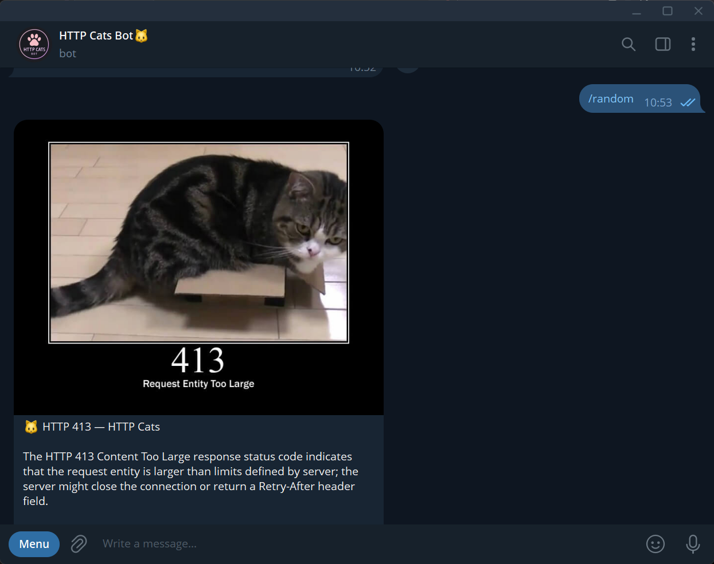

<h1 align="center">🐱 HTTP Cats Bot</h1>

HTTP Cats Bot is a Telegram bot that helps users explore HTTP status codes through cat pictures and short descriptions. Send a status code, choose one from the popular codes menu, or use the `/random` command to discover a random supported status code.

The bot uses [HTTP Cats](https://http.cat/) to retrieve cat images and [Beautiful Soup](https://www.crummy.com/software/BeautifulSoup/) to extract status titles and descriptions from web pages.

## Project Goals

The goal of this project is to practice Python development, asynchronous programming, working with external web services, and building interactive Telegram bots.

The project also demonstrates modular application architecture, environment variable management, input validation, error handling.

## Tech Stack

| Technology       | Purpose                                           |
| ---------------- | ------------------------------------------------- |
| Python 3.13      | Main programming language                         |
| aiogram 3        | Telegram Bot API integration and message handling |
| asyncio          | Asynchronous application execution                |
| aiohttp          | Asynchronous HTTP requests                        |
| aiohttp-socks    | Optional SOCKS proxy support for HTTP requests    |
| Beautiful Soup 4 | Parsing HTML and extracting status descriptions   |
| python-dotenv    | Loading environment variables from `.env`         |
| HTTP Cats        | Source of HTTP status cat images and descriptions |
| Telegram Bot API | Communication with users                          |

## Features

- **HTTP status lookup** — send a supported three-digit HTTP status code to receive the corresponding cat image and description.
    
- **Popular status codes** — open an inline keyboard and select a status code without typing it manually.
    
- **Random status** — use `/random` to get a cat for a randomly selected supported status code.
    
- **Status descriptions** — retrieve titles and explanations from HTTP Cats.
    
- **Fallback descriptions** — use predefined descriptions when the website is unavailable or its content cannot be parsed.
    
- **Input validation** — reject malformed and unsupported status codes.
    
- **Error handling** — provide a text response if Telegram cannot send the cat image.
    
- **Optional proxy** — configure a proxy for Telegram and external HTTP requests when necessary.
    

## Commands

|Command|Description|
|---|---|
|`/start`|Display the welcome message and main menu|
|`/random`|Send a cat for a random supported HTTP status code|

Users can also send a status code directly, such as `200`, `404`, or `418`, or select a code from the inline keyboard.

## Screenshots

Add your bot screenshots to the `docs_screenshots/` directory and uncomment or update the examples below.

### Welcome Message and Main Menu

<p align="center">
  <a href="https://raw.githubusercontent.com/Tr-Veronika/telegram-bot-HTTP-Cats/refs/heads/main/docs_screenshots/1_start_menu.png">
    
  </a>
  <a href="https://raw.githubusercontent.com/Tr-Veronika/telegram-bot-HTTP-Cats/refs/heads/main/docs_screenshots/2_start_menu.png">
    
  </a>
</p>


### Popular HTTP Status Codes

<p align="center">  
  
</p>  


### Cat Image and Status Description

<p align="center">
  <a href="https://raw.githubusercontent.com/Tr-Veronika/telegram-bot-HTTP-Cats/refs/heads/main/docs_screenshots/4_status_text.png">
    
  </a>
  <a href="https://raw.githubusercontent.com/Tr-Veronika/telegram-bot-HTTP-Cats/refs/heads/main/docs_screenshots/5_status_text.png">
    
  </a>
</p>

### Random Status

<p align="center">  
  
</p>

## Project Structure

```
QA_tg_bot/
├── bot/
│   ├── data/
│   │   ├── __init__.py
│   │   ├── http_statuses.py
│   │   └── messages.py
│   ├── handlers/
│   │   ├── __init__.py
│   │   └── handlers_status_code.py
│   ├── keyboards/
│   │   ├── __init__.py
│   │   └── status.py
│   ├── services/
│   │   ├── __init__.py
│   │   └── http_cat.py
│   ├── config.py
│   └── constants.py
├── .env
├── .gitignore
├── main.py
├── requirements.txt
└── README.md
```

### Main Modules

- `main.py` — initializes the bot and dispatcher, registers the router, configures logging, and starts long polling.
    
- `bot/config.py` — loads environment variables, including the Telegram bot token and optional proxy URL.
    
- `bot/handlers/handlers_status_code.py` — processes commands, text messages, and inline keyboard callbacks.
    
- `bot/keyboards/status.py` — creates inline keyboards for the main menu and popular HTTP status codes.
    
- `bot/data/http_statuses.py` — stores supported status codes and fallback descriptions.
    
- `bot/data/messages.py` — contains bot messages and responses to unsupported input.
    
- `bot/services/http_cat.py` — retrieves status descriptions, parses HTML, validates supported codes, and handles external request failures.
    
- `bot/constants.py` — stores shared constants used by the service layer.
    
- `.env` — stores local configuration and credentials (`env.example` provides a template for environment variables without real secrets).
    
- `.gitignore` — excludes environment files, virtual environments, and local development files from Git.
    
- `requirements.txt` — lists the Python dependencies required by the project.
    

## Local Installation and Setup

This guide explains how to run the bot locally on Windows, macOS, or Linux.

### 1. Prerequisites

Before starting, make sure you have installed:

- Python 3.13 or a compatible version.
    
- Git.
    
- Telegram.
    
- An IDE or code editor, such as PyCharm or VS Code.
    

You will also need a Telegram bot token. An HTTP Cats API key is not required. The instructions below explain how to obtain your Telegram bot token.

### 2. Clone the Repository

Open a terminal and clone the repository:

```bash
git clone https://github.com/Tr-Veronika/telegram-bot-HTTP-Cats.git
```

Navigate to the project directory:

```bash
cd telegram-bot-HTTP-Cats
```

You can also download the repository as a ZIP archive from GitHub and extract it locally.

### 3. Create a Virtual Environment

A virtual environment keeps the project's dependencies separate from other Python projects.

Create the environment:

```bash
python -m venv .venv
```

On systems where `python` is not available, use:

```bash
python3 -m venv .venv
```

#### Activate the Virtual Environment

**Windows — PowerShell:**

```powershell
.venv\Scripts\Activate.ps1
```

**Windows — Command Prompt:**

```bat
.venv\Scripts\activate.bat
```

**macOS and Linux:**

```bash
source .venv/bin/activate
```

After activation, `(.venv)` should appear at the beginning of your terminal prompt.

If PowerShell prevents script execution, use Command Prompt or run Python directly from the virtual environment.

### 4. Install Dependencies

With the virtual environment activated, install the dependencies:

```bash
python -m pip install -r requirements.txt
```

The project uses the libraries listed in `requirements.txt`. Installing them through this file ensures that the required dependencies are installed together.

### 5. Create a Telegram Bot

The bot token is required to connect your application to Telegram.

1. Open [@BotFather](https://t.me/BotFather) in Telegram.
    
2. Send `/newbot`.
    
3. Choose a display name for your bot.
    
4. Choose a unique username ending in `bot`.
    
5. Copy the token provided by BotFather.
    

If you already have a Telegram bot, you can use its existing token.

**Security note:** Never publish your bot token or commit it to a public repository. If a token is exposed, revoke it through BotFather and generate a replacement.

### 6. Configure Environment Variables

Create a `.env` file in the project root, next to `main.py`.

You can use `env.example` as a template.

Add the following variables:

```text
BOT_TOKEN=your_telegram_bot_token
PROXY_URL=
HTTP_TIMEOUT_SECONDS=20
```

Replace `your_telegram_bot_token` with the token obtained from BotFather.

|Variable|Required|Description|
|---|---|---|
|`BOT_TOKEN`|Yes|Telegram bot token|
|`PROXY_URL`|No|Optional proxy URL|
|`HTTP_TIMEOUT_SECONDS`|No|Timeout for HTTP Cats requests; defaults to `20` seconds|

#### Optional Proxy Configuration

A proxy may be necessary if Telegram or HTTP Cats is inaccessible from your network.

For example, if a local SOCKS5 proxy is running on port `1080`, configure it as follows:

```dotenv
PROXY_URL=socks5://127.0.0.1:1080
```

Use the address and port of your actual proxy server.

If you do not need a proxy, leave `PROXY_URL` empty or omit the variable. The application should then connect directly.

The proxy must be configured separately in the application's Telegram session and in the HTTP client used for requests to HTTP Cats.

**Important:** Keep `.env` out of Git. The repository includes `.gitignore` to prevent accidental commits of local secrets.

### 7. Run the Bot

Make sure the virtual environment is activated and `.env` is configured.

Start the application from the project root:

```bash
python main.py
```

Alternatively:

```bash
python3 main.py
```

If the application starts successfully, it will begin polling Telegram for updates.

Open your bot in Telegram and try the following:

1. Send `/start` to see the welcome message and main menu.
    
2. Press **Popular status codes** to open the list of available codes.
    
3. Select a code, such as `404 Not Found`.
    
4. Send an HTTP status code directly as a message.
    
5. Send `/random` to receive a cat for a random supported status code.
    

To stop the bot, press `Ctrl+C` in the terminal.

## Error Handling

The bot includes fallback behavior for common failures:

- Invalid input triggers a random playful response.
    
- Unsupported status codes are rejected.
    
- Network errors and timeouts are logged and handled.
    
- Predefined descriptions are used when available.
    
- Unexpected HTML content is handled without relying exclusively on live website data.
    
- If sending a cat image fails, the bot attempts to send the status title and description as text.
    

## Troubleshooting

### Python Is Not Recognized

Check that Python is installed and available in your system's PATH. Try `python3` if `python` is not recognized.

### Virtual Environment Activation Fails

Make sure you are using the command appropriate for your operating system. You can also run the interpreter directly from `.venv`.

### Invalid Telegram Token

Check the `BOT_TOKEN` value in `.env`. Make sure there are no extra spaces and that the token is current.

### Telegram Connection Errors

Check your internet connection and verify that Telegram is accessible from your network. If necessary, configure a working proxy using `PROXY_URL`.

### HTTP Cats Requests Fail

Check that `http.cat` is accessible. If the website is unavailable, the bot may use predefined descriptions for supported codes. Descriptions not included in the fallback data may be unavailable temporarily.

### Import Errors

Run `main.py` from the project root rather than from inside the `bot` directory. Check that the imports match your actual file and package structure.

### Missing Dependencies

Activate the correct virtual environment and run:

```bash
python -m pip install -r requirements.txt
```

## Future Improvements

Possible extensions for the project include:

- Tests for Telegram handlers and inline keyboard callbacks.
    
- Continuous integration with GitHub Actions.
    
- Improved logging and monitoring of external requests.
    
- Additional status-code information and interactive learning features.
    
